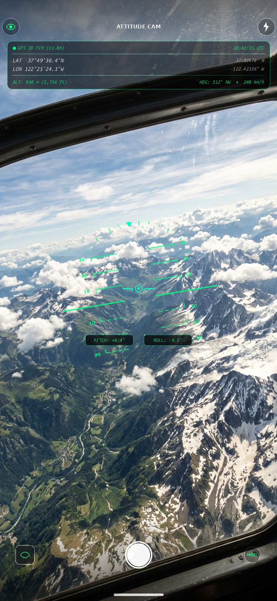

# AttitudeCam

**AttitudeCam** is an open-source iOS camera app built with SwiftUI that overlays real-time avionics telemetry—including an artificial horizon (pitch & roll), GPS coordinates, altitude, and compass heading—directly onto your live camera viewfinder and captured photos.

<p align="center">
  
</p>

---

## Features

- **Live Artificial Horizon (HUD):**
  - Aircraft boresight reticle and crosshairs at center.
  - Dynamic horizon line and pitch ladder (+/- 60°) calibrated for portrait device orientation.
  - Roll arc with real-time bank angle pointer.
  - Digital readout badges (`PITCH: +X.X°  ROLL: +X.X°`).
  - Toggle button to show or hide the HUD on demand.

- **Real-Time GPS & Telemetry Card:**
  - Latitude and Longitude in both **DMS** (`DD°MM'SS.S" N/S`) and **Decimal Degrees**.
  - Altitude in meters and feet.
  - Compass heading with numeric degrees and cardinal/intercardinal direction (e.g. `185° S`).
  - Real-time GPS accuracy indicator (`±X.X m`) and fix status.
  - Timestamp in local time and UTC.

- **Photo Capture & Telemetry Overlay:**
  - One-tap shutter button with haptic feedback and screen flash.
  - Automatically composites the visual telemetry header and artificial horizon HUD onto the final image.
  - Automatically saves the composited photo directly to your device's **Photos Library**.

- **Embedded EXIF & GPS Metadata:**
  - Writes standard `kCGImagePropertyGPSDictionary` tags (latitude, longitude, altitude, heading, speed, UTC timestamp).
  - Embeds pitch, roll, and sensor readings directly into standard **EXIF UserComment** and **TIFF ImageDescription** tags for inspection with any EXIF viewer.

- **Built-In Captures Gallery:**
  - Swipeable full-screen paging gallery to scroll through all captures.
  - Horizontal thumbnail scrubber for quick scrubbing.
  - Single-action deletion synchronized with iOS Photos Library.
  - Native iOS Share sheet integration.

---

## Tech Stack & Architecture

- **UI:** SwiftUI (iOS 17+)
- **Camera & Video:** `AVFoundation` (`AVCaptureSession`, `AVCapturePhotoOutput`, `AVCaptureVideoPreviewLayer`)
- **Sensors & Attitude:** `CoreMotion` (`CMMotionManager`)
- **Location & Heading:** `CoreLocation` (`CLLocationManager`)
- **Photo Library:** `Photos` (`PHPhotoLibrary`)
- **Metadata Encoding:** `ImageIO` (`CGImageDestination`, `CGImageSource`)
- **Tooling:** Swift Package Manager & [xtool](https://xtool.sh) (builds and deploys natively on Linux, macOS, and Windows via WSL)

---

## Getting Started

### Prerequisites

- **Swift 6.0+** toolchain
- **[xtool](https://xtool.sh)** command-line utility
- Connected iOS device (iOS 17+) with Developer Mode enabled

### Build and Run

1. Clone this repository:
   ```bash
   git clone https://github.com/foofoodog/AttitudeCam.git
   cd AttitudeCam
   ```

2. Build the app:
   ```bash
   xtool dev build
   ```

3. Connect your iPhone via USB and deploy:
   ```bash
   xtool dev
   ```

---

## License

MIT License. See [LICENSE](LICENSE) for details.
